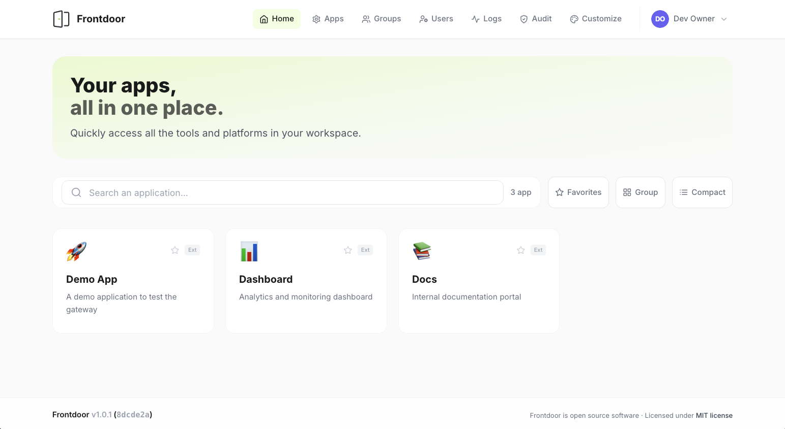

# Frontdoor

**Your apps, all in one place.**

Frontdoor is a self-hosted, open-source homepage for the internal tools your team uses every day. Sign in once with Microsoft SSO, see exactly the apps you are authorized to use, and launch them in one click — no juggling bookmarks, no "which subdomain was it?", no stale sessions. Admins manage who sees what through groups and per-group visibility, and can tailor the homepage's look and branding from the UI.

Built for IT teams who got tired of intranet wikis full of half-broken links.



## Architecture

```
                          frontdoor.example.com
                          +-----------------------------+
                          |         FRONTDOOR            |
  User ---- SSO ------>  |  Login + App Catalog          |
                          |  (Express + React + SQLite)  |
                          +----------+------------------+
                                     |
          +--------------------------+-------------------------+
          |                          |                         |
          v                          v                         v
  app1.example.com          app2.example.com          app3.example.com
  +-------------------+    +-------------------+    +-------------------+
  |   Your App 1      |    |   Your App 2      |    |   Your App 3      |
  |  (redirect target)|    |  (redirect target)|    |  (redirect target)|
  +-------------------+    +-------------------+    +-------------------+
```

Each app in the catalog is accessible via its target URL. The gateway handles authentication and provides SSO redirect, shared-cookie, or plain link modes.

## Stack

| Component | Technology |
|-----------|------------|
| Backend | Node.js 24 LTS + Express 5 |
| Frontend | React 19 + React Router 8 + Vite 8 + Tailwind CSS 4 |
| Database | SQLite (better-sqlite3 13) |
| Auth | Microsoft SSO (@azure/msal-node 7) + JWT |
| State | Zustand 5 |
| Quality | ESLint, Node test runner (unit + HTTP), GitHub Actions CI, Dependabot |
| Deploy | Docker multi-stage (`node:24-bookworm-slim`) |

## Features

See [FEATURES.md](FEATURES.md) for the full capability map. Highlights:

- Microsoft SSO authentication
- App catalog with search, tags, favorites
- Group-by-tag view
- RBAC: groups, per-group app visibility, and role tiers (`owner`, `admin`, `admin_readonly`)
- RBAC discovery from Microsoft Entra groups at login, with admin import/force-sync flows
- Admin panel: manage apps, users, groups, logs, audit, and branding
- Access logs with analytics, period filters, page size selection, and search
- Dedicated audit trail for privileged actions with actor filtering and pagination
- App icons support emojis, pasted images, and pasted SVG assets with disk cache
- SSO redirect mode (JWT forwarding to target apps)
- Shared-cookie mode (wildcard domain cookie)
- Plain link mode (simple external redirect)
- Bulk app upsert API (for CI/automation)
- Demo apps are optional and can be restored from the admin panel or with `npm run db:seed`
- Home hero text, company logo, homepage/login behavior, and app visibility toggles can be customized from the **Personalizza** admin page

## Quick Start (Node.js)

Requires **Node.js 24** or newer.

```bash
# 1. Install dependencies
npm install

# 2. Configure environment
cp .env.example.node .env
# Edit .env with your Azure AD credentials (or use DEV_LOGIN, see below)

# 3. Start in dev mode (Vite + Express in parallel)
npm run dev
```

Frontend: http://localhost:5173 | API: http://localhost:3001

The backend restarts automatically when files in `server/` or `shared/` change (Node's built-in `--watch`).

### Checks

CI runs the same commands on every pull request; run them before opening one:

```bash
npm run lint         # ESLint (no errors allowed)
npm test             # unit and HTTP tests, each test process gets its own temporary database
npm run check:i18n   # English and Italian dictionaries stay aligned
npm run build        # production frontend build
```

CI also builds the Docker image and smoke-tests it (`/api/health` and the SPA shell).

### Dev Login (no Azure required)

To run Frontdoor locally without an Azure AD app registration, enable the dev login mode:

```bash
DEV_LOGIN=true
```

When `DEV_LOGIN=true` and `NODE_ENV` is not `production`:
- Azure AD credentials are **not required** — the server starts without them
- A `JWT_SECRET` fallback is generated automatically if not set
- The login page shows a **Dev Login** panel where you can pick a role (`owner`, `admin`, `admin_readonly`, `user`) and enter immediately
- A local dev user is created in the database on first use

This is the recommended way to explore and develop on Frontdoor without configuring Microsoft Entra. The dev login is completely disabled in production (`NODE_ENV=production`) regardless of the `DEV_LOGIN` value.

## Quick Start (Docker)

```bash
# 1. Configure environment
cp .env.example.docker .env
# Edit .env with your Azure AD credentials

# 2. Build and run
docker compose up --build
```

App: http://localhost:3001

The image stores every writable path on the `/data` volume by default (`DATABASE_PATH=/data/frontdoor.db`, avatar, app icon, branding and plugin directories), so data survives image upgrades.

> **Dev vs Docker**: In dev mode, Vite serves the frontend on port 5173 and proxies API calls to Express on 3001. In Docker, Express serves both the built frontend and API on port 3001. The two `.env.example.*` files are pre-configured for each mode.

## Configuration

### Environment Variables

| Variable | Description | Default |
|----------|-------------|---------|
| `DEV_LOGIN` | Enable local dev login without Azure SSO (ignored in production) | `false` |
| `PORT` | Express server port | `3001` |
| `DATABASE_PATH` | SQLite file path | `./frontdoor.db` |
| `AVATAR_CACHE_DIR` | Disk cache for user avatars and metadata | `./data/avatar-cache` |
| `APP_ICON_CACHE_DIR` | Disk cache for uploaded app icons and pasted SVG assets | `./data/app-icon-cache` |
| `BRANDING_ASSET_DIR` | Disk storage for the optional company logo | `./data/branding` |
| `PLUGIN_ASSET_DIR` | Disk storage for plugin packages (plugin system currently locked off) | `./data/plugins` |
| `AVATAR_CACHE_TTL_DAYS` | Refresh interval for cached Microsoft 365 / Gravatar avatars | `14` |
| `AVATAR_CACHE_MISS_TTL_DAYS` | Retry interval when no avatar was found | `30` |
| `BASE_DOMAIN` | Base domain (no protocol) | `frontdoor.local` |
| `FRONTEND_URL` | Frontend URL with protocol (see `.env.example.*`) | - |
| `CORS_ALLOWED_ORIGINS` | Comma-separated allowlist of origins that can call Frontdoor with `credentials: 'include'` for shared-cookie or session-check pages | - |
| `AZURE_CLIENT_ID` | Azure AD App Registration Client ID | - |
| `AZURE_CLIENT_SECRET` | Azure AD Client Secret | - |
| `AZURE_TENANT_ID` | Azure AD Tenant ID | - |
| `AZURE_REDIRECT_URI` | SSO callback redirect URI | - |
| `JWT_SECRET` | JWT signing secret | - |
| `ENTRA_GROUP_SYNC` | Discover Entra group memberships at login and enable admin import/force-sync flows | `false` |
| `JWT_EXPIRES_IN` | JWT token duration | `7d` |
| `ADMIN_EMAILS` | Comma-separated owner emails (auto-promoted) | - |
| `ADMIN_API_KEY` | API key for bulk endpoints | - |

#### Production checklist

For a real deployment, set at least:

- `BASE_DOMAIN`
- `FRONTEND_URL`
- `CORS_ALLOWED_ORIGINS` if you want a static page or satellite app on another origin to call Frontdoor with credentials
- `AZURE_CLIENT_ID`
- `AZURE_CLIENT_SECRET`
- `AZURE_TENANT_ID`
- `AZURE_REDIRECT_URI`
- `JWT_SECRET`
- `ENTRA_GROUP_SYNC` if you want Entra group sync enabled
Recommended but optional:

- `ADMIN_EMAILS`
- `ADMIN_API_KEY`
- `JWT_EXPIRES_IN`
- Tenant default time zone from `Personalizza` if you want something other than UTC

If one of the required values is missing or malformed, the container now fails fast at startup with a clear log entry instead of surfacing a runtime auth error later.

#### Cross-origin session checks

`CORS_ALLOWED_ORIGINS` is meant for pages that only need to check whether a user already has an active Frontdoor session, for example a plain static HTML page or a lightweight download/launch page hosted on a sibling domain.

If you host a page on `https://contoso.com`, set:

```bash
CORS_ALLOWED_ORIGINS=https://contoso.com
```

Then the page can ask Frontdoor whether the current browser session is already authenticated:

```html
<script>
  async function checkSession() {
    const response = await fetch('https://frontdoor.contoso.com/api/auth/me', {
      credentials: 'include',
    });

    if (response.ok) {
      const user = await response.json();
      console.log('Signed in as:', user.email || user.display_name);
      return;
    }

    window.location.href = 'https://frontdoor.contoso.com/login';
  }

  checkSession().catch(() => {
    window.location.href = 'https://frontdoor.contoso.com/login';
  });
</script>
```

The important part is `credentials: 'include'`: it tells the browser to send the `frontdoor_token` cookie with the request. Frontdoor will only accept that cross-origin request if the page origin is listed in `CORS_ALLOWED_ORIGINS`.

#### Roles and access tiers

Frontdoor supports four role values:

- `owner` - full access, including Log, Audit, and Personalizza
- `admin` - full admin access except Log and Personalizza
- `admin_readonly` - can view admin pages but cannot modify data
- `user` - standard app-catalog user

Users listed in `ADMIN_EMAILS` are auto-promoted to `owner` and remain protected from web UI changes while they stay in the compose/run list.

Only `owner` can access Log, Audit, and Personalizza. `admin` and `admin_readonly` can access Gestione App, Gruppi, and Utenti; the latter is read-only.

#### Criteri di conservazione

Frontdoor keeps user avatars on disk inside `AVATAR_CACHE_DIR`. In Docker the recommended target is the shared `/data` volume so cached images survive container restarts.

- Microsoft 365 photos are fetched from Microsoft Graph when users sign in, and can also be prewarmed with the dedicated utility or refreshed from `Personalizza`.
- If Microsoft does not expose a photo, Frontdoor falls back to Gravatar and then to the text avatar.
- Cached avatars are refreshed only after the TTL expires, so the UI does not hit Graph on every page load.
- The **Personalizza** page includes a maintenance action to refresh the avatar cache when Microsoft 365 profile photos change.
- The same **Personalizza** page also includes a log retention selector from 0 to 90 days.
- `0` means logless: at the next scheduled cleanup cycle Frontdoor purges both access logs and audit logs from the database.
- The purge is not immediate when you save the setting, so an admin can still revert the change before the next cleanup runs.
- The default retention stays at 90 days.

To prewarm the avatar cache for existing users, run:

```bash
npm run avatars:prewarm
```

If you want the utility or the `Personalizza` refresh action to fetch Microsoft 365 photos for existing users, grant the app the Microsoft Graph application permission `ProfilePhoto.Read.All` and admin consent.

#### Home branding

The home hero text, optional company logo, homepage/login behavior, and app badge visibility are managed from the **Personalizza** page in the admin panel.

- The text fields update the hero copy shown on the home page.
- The logo is uploaded to `BRANDING_ASSET_DIR` and served back from the app.
- If no logo is configured, the home page keeps the current text-only layout.
- The `Mostra banner hero in Home` option hides the big landing banner.
- The `Home compatta di default` option defines the tenant-wide compact/default home view, but users can still override it locally in their browser.
- The `Vai subito alla Login SSO` option skips the login page and redirects directly to Microsoft sign-in.
- The `Mostra badge ext / SSO sulle app` option controls whether app cards show mode badges.
- The `Mostra Shared Cookie`, `Mostra Redirect SSO`, and `Mostra Entra App` options hide those app-mode buttons in the admin app editor.
- The `Criteri di conservazione` section lets an owner invalidate the cached avatars and tune log retention so Microsoft/Gravatar changes and retention policy updates are picked up on the next cycle.

#### Audit and retention

- Log and Audit timestamps are stored in UTC and rendered using the app/tenant/user time zone settings, while the database continues to store UTC values.
- Audit includes an owner-only admin filter so you can narrow the view to a single privileged account.
- Frontdoor automatically purges `access_logs` and `rbac_audit_logs` entries older than 90 days at startup and then once per day.

#### App icons

App icons can be entered as:

- emoji or simple text in the icon field
- pasted images copied from your computer or browser
- pasted SVG markup

Uploaded or pasted icon assets are stored on disk inside `APP_ICON_CACHE_DIR` and served by Frontdoor with a long-lived cache. The public URL is versioned by `updated_at`, so browsers refresh the icon only after an admin saves a change.

When you create a new app in the admin panel, you can choose one or more Frontdoor groups to grant visibility immediately. If you do not select any group, the app is created without permissions.

#### Startup logs

On boot, the server prints a redacted config summary such as:

```text
Frontdoor startup configuration:
  NODE_ENV=production
  PORT=3001
  DATABASE_PATH=/data/frontdoor.db
  BRANDING_ASSET_DIR=/data/branding
  BASE_DOMAIN=contoso.com
  FRONTEND_URL=https://frontdoor.contoso.com
  AZURE_CLIENT_ID=[set]
  AZURE_CLIENT_SECRET=[set]
  AZURE_TENANT_ID=[set]
  AZURE_REDIRECT_URI=https://frontdoor.contoso.com/api/auth/microsoft/callback
  JWT_SECRET=[set]
  ADMIN_EMAILS=1 owner configured
  ENTRA_GROUP_SYNC=true
```

Warnings are emitted for defaults or weak-but-valid settings, for example:

- `BASE_DOMAIN is not set, defaulting to frontdoor.local`
- `JWT_SECRET is shorter than 32 characters; use a longer random secret in production`
If `ENTRA_GROUP_SYNC=true`, Frontdoor discovers Microsoft Entra groups at login (a tenant-wide refresh of the group catalog via `/groups`, followed by a per-user membership fetch via `/users/{id}/transitiveMemberOf`), stores them in a discovery cache, and lets admins import only the groups they actually want to use in Frontdoor. Both calls are made with an **app-only** Microsoft Graph token, so the user's login token is never asked for any group-read scope — the login consent screen stays on the minimal `openid / profile / email / User.Read` delegated set. The admin Force Sync flow uses the same app-only path to refresh the tenant-wide group catalog plus every user's memberships in one shot.

Because of the app-only calls, your app registration must have the Microsoft Graph **application** permissions listed in Step 4 (`User.Read.All`, `GroupMember.Read.All`, optionally `Group.Read.All`), all with admin consent. The first time you enable `ENTRA_GROUP_SYNC=true`, add the permissions in Azure, grant consent, then trigger a fresh login or Force Sync to populate the cache.

Important: discovery and import are separate steps. If you delete imported Entra groups from Frontdoor's local database, they will not be recreated automatically as active RBAC groups on the next login. They must first be rediscovered by a successful login or Force Sync, then imported again from the Entra import modal.

### Azure Entra ID (formerly Azure AD) Setup

Frontdoor uses Microsoft Entra ID for SSO authentication via the OAuth 2.0 Authorization Code flow with MSAL.

#### Step 1: Create an App Registration

1. Go to [Azure Portal](https://portal.azure.com) > **Microsoft Entra ID** > **App registrations** > **New registration**
2. **Name:** `Frontdoor` (or any name you prefer)
3. **Supported account types:** Choose based on your needs:
   - *Single tenant* — only users from your organization (most common)
   - *Multitenant* — users from any Azure AD organization
4. **Redirect URI:** Select **Web** and enter:
   - Production: `https://your-domain.com/api/auth/microsoft/callback`
   - Local dev: `http://frontdoor.local:3001/api/auth/microsoft/callback`
5. Click **Register**

#### Step 2: Note the identifiers

From the **Overview** page of your new app registration, copy:
- **Application (client) ID** → `AZURE_CLIENT_ID`
- **Directory (tenant) ID** → `AZURE_TENANT_ID`

#### Step 3: Create a Client Secret

1. Go to **Certificates & secrets** > **Client secrets** > **New client secret**
2. Add a description (e.g., "Frontdoor production") and set expiration
3. Copy the **Value** immediately (it won't be shown again) → `AZURE_CLIENT_SECRET`

#### Step 4: Configure API Permissions

1. Go to **API permissions** > **Add a permission** > **Microsoft Graph** > **Delegated permissions**
2. Add these permissions:
   - `openid` — Sign users in
   - `profile` — Read user profile (display name)
   - `email` — Read user email address
   - `User.Read` — Read signed-in user's basic profile
3. Click **Grant admin consent** (if you're a tenant admin) — otherwise ask your admin

If you want to use **Sincronizza gruppi** (or enable `ENTRA_GROUP_SYNC=true` for login-time discovery), also add the following Microsoft Graph **application** permissions and grant admin consent:

- `User.Read.All` — required by `/users/{id}/transitiveMemberOf` to fetch each user's group memberships app-only
- `GroupMember.Read.All` — required by `/groups/{id}/transitiveMembers` to fetch imported group members app-only
- `Group.Read.All` *(optional)* — grants broader group object reads (description, visibility, ...); harmless if not needed today but useful for future group metadata features

Both the login flow and the Force Sync action call Graph app-only, so without these application permissions the group features will return 403 errors even if the user is a global admin.

#### Step 5: Set environment variables

```bash
AZURE_CLIENT_ID=xxxxxxxx-xxxx-xxxx-xxxx-xxxxxxxxxxxx
AZURE_CLIENT_SECRET=your-client-secret-value
AZURE_TENANT_ID=xxxxxxxx-xxxx-xxxx-xxxx-xxxxxxxxxxxx
AZURE_REDIRECT_URI=https://your-domain.com/api/auth/microsoft/callback
```

#### Security Notes

- The OAuth flow uses PKCE and state parameters for CSRF protection
- Tokens from Microsoft are validated by the MSAL library (signature verification against Azure's public keys)
- The JWT token issued by Frontdoor is stored only in an httpOnly cookie (not accessible to JavaScript)
- User profile data passed to the frontend does not include the token
- The client secret should be rotated periodically and never committed to source control

## API

| Method | Endpoint | Auth | Description |
|--------|----------|------|-------------|
| GET | `/api/health` | No | Health check |
| GET | `/api/auth/microsoft` | No | Initiate SSO flow |
| GET | `/api/auth/microsoft/callback` | No | SSO callback |
| GET | `/api/auth/me` | Bearer | Current user profile |
| POST | `/api/auth/verify-sso-token` | None (token+aud in body) | SSO token introspection for satellite apps |
| POST | `/api/auth/logout` | No | Logout (clear cookie) |
| GET | `/api/branding` | Bearer | Read home branding settings |
| PUT | `/api/branding` | Owner | Update home branding settings |
| GET | `/api/branding/logo` | No | Serve optional company logo |
| GET | `/api/apps` | Bearer | List active apps (RBAC filtered) |
| GET | `/api/apps/all` | Admin viewer | List all apps (including inactive) |
| GET | `/api/apps/:id/icon` | Bearer | Serve a custom app icon asset |
| POST | `/api/apps` | Admin editor | Create app |
| POST | `/api/apps/restore-defaults` | Admin editor | Restore the default demo apps |
| PUT | `/api/apps/:id` | Admin editor | Update app |
| DELETE | `/api/apps/:id` | Admin editor | Delete app |
| GET | `/api/apps/bulk` | API Key | Bulk export apps (full metadata) |
| POST | `/api/apps/bulk` | API Key | Bulk upsert apps |
| GET | `/api/users` | Admin viewer | List users |
| PUT | `/api/users/:id/role` | Admin editor | Change user role |
| PUT | `/api/users/:id/active` | Admin editor | Activate/deactivate user |
| DELETE | `/api/users/:id` | Admin editor | Delete user |
| GET | `/api/groups` | Admin viewer | List groups |
| GET | `/api/groups/entra/candidates` | Admin viewer | List discovered Entra groups available for import |
| POST | `/api/groups/entra/import` | Admin editor | Import selected discovered Entra groups |
| POST | `/api/groups/entra/force-sync` | Admin editor | Force sync Entra memberships for all linked users |
| POST | `/api/groups/bulk-delete` | Admin editor | Delete multiple groups at once |
| POST | `/api/groups` | Admin editor | Create group |
| PUT | `/api/groups/:id` | Admin editor | Update group |
| DELETE | `/api/groups/:id` | Admin editor | Delete group |
| POST | `/api/groups/:id/members` | Admin editor | Add members |
| DELETE | `/api/groups/:id/members/:userId` | Admin editor | Remove member |
| POST | `/api/groups/:id/apps` | Admin editor | Assign apps |
| DELETE | `/api/groups/:id/apps/:appId` | Admin editor | Remove app |
| GET | `/api/logs` | Owner | Access logs (paginated) |
| GET | `/api/logs/top-apps` | Owner | Top apps analytics |
| GET | `/api/logs/audit` | Owner | Audit logs (paginated) |

### Auth integration patterns for satellite apps

Apps in the catalog can pick one of three patterns to consume frontdoor authentication. Pick the most restrictive that fits the deployment.

| Pattern | When to use | What the satellite needs |
|---------|-------------|--------------------------|
| **Shared cookie** (`mode=shared-cookie`) | Satellite hosted under a subdomain of `BASE_DOMAIN`. | Read the `frontdoor_token` httpOnly cookie and verify it locally with the shared `JWT_SECRET`. |
| **Redirect with shared secret** (`mode=redirect`, classic) | Satellite on a different domain, operated by the same team. | Receive the short-lived token via GET query string or POST form, verify it locally with the shared `JWT_SECRET`. |
| **Redirect with introspection** (`mode=redirect`, A.3) | Satellite on a different domain that should NOT hold the frontdoor secret (third-party, lower-trust environment, blast-radius reduction). | Receive the short-lived token, then POST it to `/api/auth/verify-sso-token` together with its own slug as `expected_aud`. No shared secret. |

#### `POST /api/auth/verify-sso-token`

Server-to-server token introspection (RFC 7662-inspired, scoped to this flow). The frontdoor verifies signature, expiration, issuer (`JWT_ISSUER` or `frontdoor`), audience match, user activation and app activation in one shot. Authorization to call the endpoint is implicit in possessing a valid token for the requested `expected_aud`; no API key needed.

```bash
curl -sX POST https://<frontdoor-host>/api/auth/verify-sso-token \
  -H 'Content-Type: application/json' \
  -d '{"token":"<jwt>","expected_aud":"<your-app-slug>"}'
```

200 response:

```json
{
  "valid": true,
  "user": { "id": "...", "email": "...", "name": "...", "role": "user" },
  "aud": "<your-app-slug>",
  "exp": 1745740300
}
```

Error codes:

| Status | `error` | Meaning |
|--------|---------|---------|
| 400 | `bad_request` | Missing/malformed `token` or `expected_aud` (slug regex). |
| 401 | `invalid_token` | Bad signature or expired (intentionally indistinguishable). |
| 401 | `invalid_issuer` | Token wasn't issued by this frontdoor. |
| 401 | `user_not_found_or_inactive` | `sub` doesn't resolve to an active user. |
| 403 | `audience_mismatch` | Token replay across apps — caller logged at `warn`. |
| 403 | `app_inactive` | `expected_aud` matches an app that has been deactivated. |
| 429 | `too_many_requests` | Rate limit (120 req/min per IP) tripped. |

Use `exp` to scope the local satellite session: `min(default_session_ttl, exp - now)` keeps the local session from outliving the frontdoor token.

## Database

SQLite with 15 tables:

| Table | Description |
|-------|-------------|
| `users` | Users (auto-created on first SSO login), owner/admin/admin_readonly/user roles |
| `apps` | App catalog (slug, target_url, icon, icon_file_name, description, tags) |
| `access_logs` | Proxy access logs (user, app, IP, timestamp) |
| `user_groups` | User groups for RBAC, including imported Entra groups |
| `user_group_members` | Group membership |
| `app_permissions` | Per-group app visibility |
| `entra_group_cache` | Discovered Entra groups available for admin import |
| `entra_user_group_memberships` | Cached Entra memberships per user |
| `rbac_audit_logs` | Audit trail for RBAC and privileged platform actions |
| `group_group_memberships` | Linked groups: members of a child group inherit the parent group's apps |
| `group_entra_group_memberships` | Entra groups linked to a Frontdoor group |
| `branding_settings` | Customization settings (hero texts per language, logo, Home and login behaviour, feature toggles) |
| `media_assets` | Index of uploaded app icons and branding logos stored on disk |
| `auth_pending_states` | Short-lived OAuth `state` values for in-flight SSO logins |
| `plugin_registry` | Plugin manifests and approvals (plugin system currently locked off) |

On first startup with an empty DB, example apps are seeded automatically.

Schema changes are applied automatically at startup. Table rebuilds run inside a transaction, so an interrupted upgrade never leaves a table missing or half-copied.

## Upgrading an existing installation

1. **Back up.** In **Personalizza (Customize) → Maintenance**, download a backup (database rows plus app icons, logo and avatars). With the container stopped (`docker compose stop`), also copy the SQLite file from the volume, e.g. `docker cp <container>:/data/frontdoor.db ./frontdoor.db.bak`, including `frontdoor.db-wal` if present.
2. **Rehearse (recommended).** Start the new image locally against a copy of the database and check the `[startup]` lines in the logs; alternatively restore the backup into a fresh local installation.
3. **Upgrade.** Pull or build the new image and start it on the same `/data` volume. Migrations run on startup.
4. **Verify.** Sign in with Microsoft SSO, open the admin pages, and if `ENTRA_GROUP_SYNC=true` run a Force Sync.
5. **Roll back if needed.** Start the previous image and restore the backup taken in step 1.

See [CHANGELOG.md](CHANGELOG.md) for what changed in each release.

## Contributing

Contributions are welcome. See [CONTRIBUTING.md](CONTRIBUTING.md) for development setup, the pull-request workflow, and the **DCO sign-off** requirement. Project governance, maintainers, and the decision process are documented in [GOVERNANCE.md](GOVERNANCE.md). All participants are expected to follow our [Code of Conduct](CODE_OF_CONDUCT.md).

## Security

For vulnerability reports, please follow the private disclosure process described in [SECURITY.md](SECURITY.md). Do not open a public GitHub issue for security findings.

## Brand and trademark

**Frontdoor™** is an unregistered trademark claimed by the project's original authors. The MIT license covers the source code; it does not grant rights to use the Frontdoor name, logo, or brand identity. See [TRADEMARK.md](TRADEMARK.md) for fair-use guidance and how to request permission.

## License

MIT — see [LICENSE](LICENSE). The MIT license covers the source code; for the **Frontdoor™** name and brand see [TRADEMARK.md](TRADEMARK.md).
