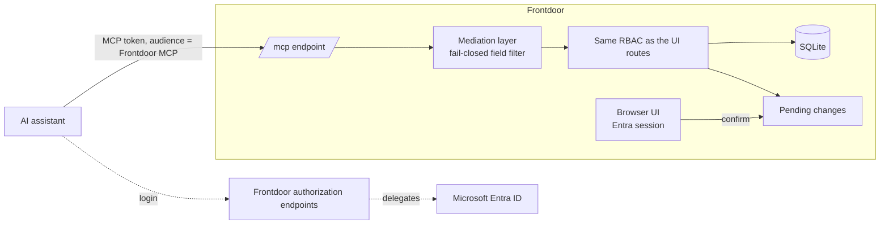

# Frontdoor MCP: ask your AI assistant instead of clicking

- Status: proposal, open questions pending (see the end)
- Date: 2026-11-02
- Author: Andrea Margiovanni
- Source: the "Frontdoor MCP" design doc on claude.ai, translated from Italian
  and versioned here so the design can be reconstructed from the repository.

Frontdoor exposes an MCP server, so users and admins use Frontdoor's features
from the AI assistant they already have (Copilot, Claude, ChatGPT) without
learning another interface. Identity stays with Microsoft Entra only, writes are
confirmed in Frontdoor with one click, and nothing reaches the AI vendor that
would let it into the tenant.

## Why

The MCP is not a new direction: it brings the principles Frontdoor already
declares to where people now work every day, the AI assistant. Frontdoor is
already the point identity passes through on its way to satellite apps; an AI
client is just another satellite app, the most used one.

The problems the site promises to solve are, by nature, questions:

- **Users:** "where is the holiday tool?" — today scattered bookmarks and
  interrupted colleagues.
- **Admins:** "which permissions were left behind?", "which links are stale?" —
  today dozens of clicks across Apps, Groups and Logs.

| Principle declared on frontdoor.buildbandits.com | How the MCP reinforces it |
| --- | --- |
| Identity stays with Microsoft | AI client login goes through the usual Entra SSO. No second IdP, no generic OIDC. |
| Sessions kept away from browser scripts | The MCP token is separate from the session cookie: own audience, short lifetime, revocable. The session JWT never leaves Frontdoor. |
| Users see only the apps they can access | Tools reuse the same RBAC as the HTTP routes: the assistant shows each person only their apps. |
| Authorization close to the protected apps | Frontdoor stays the only point that decides; the assistant proposes, it does not decide. |
| Privileged changes are traceable | Every proposal and every confirmation via MCP is audited with the AI client that originated it. |
| Data stays in the environment you choose | The MCP ships off: the owner turns it on, choosing which corporate AI assistants to admit. |

Expected result: people using Frontdoor need not know another corporate
interface exists, and Frontdoor becomes more opinionated, not less.

## What users and admins can ask

Each role can do through the assistant exactly what it can do from the UI, no
more, no less. Reads answer immediately; writes become proposals to confirm in
Frontdoor.

| Minimum role | Example request | Type |
| --- | --- | --- |
| user | "Where is the holiday portal?" → direct link, already filtered on their permissions | Read |
| user | "Which tools do I have for accounting?" (search by tag and description) | Read |
| user | "Add Jira to my favourites", "switch to dark theme" | Write to own preferences |
| admin_readonly | "Which apps are assigned to no group?", "which apps have no tags?" | Read |
| admin_readonly | "Who can see Payroll, and through which group?" | Read |
| admin | "Remove Figma from the Interns group", "give Payroll to HR Milan" | Proposal to confirm |
| admin | "Add the Invoices app with link X, tag administration, visible to Finance" | Proposal to confirm |
| admin | "Import the Entra group 'Sales Italy' and resync it" | Proposal to confirm |
| owner | "Which apps has nobody opened in 90 days?" (aggregate answer, only if the owner exposed the logs) | Read |

A user's personal preferences are the only write without confirmation: they
affect only that user and are already reversible from the UI. To be validated
with the maintainers.

## Architecture

The AI assistant talks only to Frontdoor's MCP endpoint; everything else stays
behind it.

Every request crosses the mediation layer and the same RBAC as the UI. Writes
stop in the pending changes until the admin confirms from the browser with
their Entra session.

## The mediation layer

Between the MCP tools and the data there is a filter inside Frontdoor, closed by
default: for each field the code declares whether it may leave, and what is not
declared does not leave. It lives inside Frontdoor rather than in a separate
proxy, so no second trust boundary is created.

| Class | Fields | Why |
| --- | --- | --- |
| Leaves | App name, description, tags, group name, role, counts | The assistant needs them to answer; already visible to the user in the UI |
| Leaves pseudonymised | Users (`U-7f3a` instead of name and email), IPs in logs, Entra object IDs | The assistant reasons precisely ("12 users with access to Payroll have not opened it in 90 days") without knowing who they are; Frontdoor resolves pseudonyms server side |
| Never leaves | Tenant ID, client ID, SSO endpoints, URLs of `internal-link` apps, security configuration, secrets | Reconnaissance material for entering the tenant or the internal network |
| Aggregate only | Access logs and audit | The assistant receives answers ("top 5 apps this month"), not rows |

The AI vendor receives only a token valid exclusively for Frontdoor's MCP
endpoint: short-lived, revocable, limited to the user's role. Never Entra or
Graph tokens, never the client secret, never `JWT_SECRET`, never satellite app
tokens. If that token falls into the wrong hands, at most it lets someone
propose through Frontdoor what the user can already do: no door into the tenant.

Tools are narrow and typed: no "run query", "call Graph" or "fetch URL".
Frontdoor's app-only Graph permissions (`GroupMember.Read.All`) never become a
proxy.

**Declared limit:** the layer controls what leaves Frontdoor, not what the user
types. If an admin types "remove Mario Rossi from Payroll", that name is already
at the vendor. Mitigated with tools that accept pseudonyms and clear
documentation, not eliminated.

## Writes: the assistant proposes, the admin confirms in Frontdoor

No administrative write is applied from the AI client: it becomes a proposal,
and the admin applies it with a single click in Frontdoor after reviewing it.
Even with a prompt injection (a malicious app description or group name read by
the model), the worst case is a wrong proposal nobody confirms.

1. **Proposal.** The MCP tool checks permissions with the same RBAC as the
   routes. If the admin could not do it from the UI, the proposal is not
   created. Otherwise Frontdoor stores a pending change and returns a link and a
   pseudonymised summary to the assistant.
2. **Review.** The admin opens the link with their Entra session and sees the
   full diff with real names: who gains or loses access to what, which fields
   change.
3. **One click.** Confirm or discard. On confirmation Frontdoor re-checks
   permissions and current state: if something changed meanwhile, the proposal
   lapses instead of overwriting.
4. **Trace.** The audit records the proposal ("via MCP, client X") and the
   confirmation (who, when).

Proposed rules:

- A request on many items ("remove Payroll from these 12 users") is one
  proposal and one click.
- Only the proposer confirms: no new four-eyes flow, which Frontdoor does not
  have today.
- Unconfirmed proposals expire after 24 hours.
- Reads stay immediate: they already pass the outbound filter.

## Owner controls, GDPR and revocation

The MCP ships off and is turned on by an explicit owner choice: an AI assistant
the company has a contract with falls within "the environment you choose", but
the owner chooses it.

| Control | Who | Default |
| --- | --- | --- |
| MCP enabled | owner | Off |
| Allowlist of admitted AI clients (by redirect URI: Copilot, Claude, ChatGPT…) | owner | Empty |
| Aggregate exposure of access logs and audit | owner | Off |
| Kill switch: revoke all MCP tokens at once | owner | — |
| List and revoke one's own connected AI clients | every user | — |

Access logs and audit are personal data: who opened what and when. Exposing
them, even aggregated, means having another processor handle them; that is why
they have a separate switch. The documentation (Security and Admins) states
plainly which fields reach the AI vendor when the MCP is on, so the customer's
DPO can assess it without reading the code.

## Non-goals

The MCP is another entrance to the same principles, not the occasion to
generalise Frontdoor.

- **No other IdP.** No Google, SAML or generic OIDC: human identity stays
  Microsoft Entra. For consistency, the roadmap entry "Support for additional
  SSO providers (Google, SAML)" at the bottom of the CHANGELOG should go.
- **No owner functions via MCP:** backup, restore, impersonation, log purge,
  branding. Too destructive or too rare to be worth the risk.
- **No generic tools:** free queries, Graph calls, URL fetch.
- **No AI assistant inside Frontdoor.** Frontdoor embeds no model and picks no
  vendor: it exposes the MCP, and each company uses the assistant it already has.
- **No parallel authorization path:** tools call the same logic as the routes,
  never rewritten queries.
- **No four-eyes approval** in this proposal: a separate idea, if ever needed.

## Proposed phases

Three releases, each useful on its own; phase 2 starts only once phase 1 has
held in production.

1. **Read.** AI client login via Frontdoor and Entra, outbound filter, owner
   switches, revocation. Read-only tools for user and admin_readonly, plus
   personal preferences.
2. **Admin write proposals.** Pending changes, confirmation page with diff,
   "via MCP" audit. First group and app-visibility operations, then app creation
   and edit, then Entra import and sync.
3. **Log answers for owners.** Aggregates only, only with the switch on.

## Open questions for the maintainers

- **AI client registration.** Entra, as far as we know, does not support the
  dynamic client registration many MCP clients expect. The proposal is that
  Frontdoor acts as authorization server towards AI clients and delegates login
  to Entra. To be verified against the current MCP spec and Copilot, Claude and
  ChatGPT.
- **Dependency.** The official MCP TypeScript SDK would be a new dependency:
  compatibility with Node 24 and Express 5 to verify before proposing it.
- **Transport.** HTTP endpoint on the same Express process (e.g. `/mcp`), with
  its own rate limits, or a separate process?
- **Pseudonyms.** Stable per token (the assistant can refer to `U-7f3a` across
  questions) or per single answer?
- **Plugins.** The plugin platform is locked: when it unlocks, may plugins
  expose MCP tools? The proposal is no, at least initially.
- **Preferences without confirmation.** Is it fine that they are the only write
  applied directly by the assistant?
