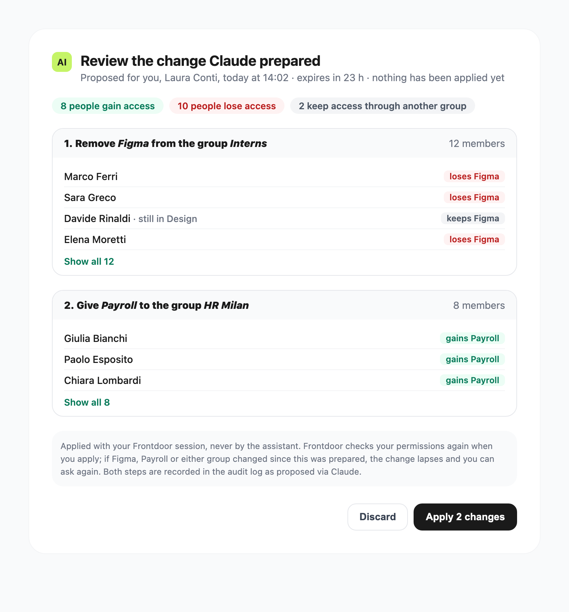

# Frontdoor MCP — phase 2 specification (admin write proposals)

- Status: draft for review
- Date: 2026-11-04
- Builds on: `01-proposal.md`, `02-phase1-spec.md`, `03-roadmap.md`, ADR 0005
- Mockup: `mockups/change-review.png` (source `mockups/change-review.html`)
- Code references are to `main` plus the phase 1 implementation (#167)

An admin asks their assistant for an access change. Frontdoor stores a pending
change, the assistant answers with a link, and the admin reviews the exact
effect in Frontdoor and applies it with one click. The assistant never applies
anything.



## 1. Scope

This spec covers the **first step of phase 2: which groups can open which
apps**. This is the `app_permissions` table that the Groups and Apps pages edit
today.

In scope:

- one MCP tool, `propose_access_change`;
- the pending-change model;
- the review page `/changes/:id`;
- apply and discard;
- the audit trail.

Out of scope, each with its own spec later (see §13):

- app creation and edit;
- Entra group import and resync;
- local group membership;
- the pseudonyms of the proposal, which become necessary only once a tool has
  to name people.

Never via MCP, as in the proposal:

- backup and restore;
- impersonation;
- log purge;
- branding;
- owner settings;
- deleting apps or groups;
- the `x-api-key` bulk endpoints.

## 2. Decisions

| Question | Decision |
| --- | --- |
| Can the MCP token apply a change? | No. It can only create a proposal. Applying requires the admin's Frontdoor session on a Frontdoor page (ADR 0005). |
| New OAuth scope? | Yes: `frontdoor.propose`. It is granted only if the user is `owner` or `admin` when consenting, and the consent page lists it as its own line. Phase 1 grants (`frontdoor.read`, `frontdoor.preferences`, ADR 0006) do not get it silently: the user reconnects. |
| Who applies? | Only the admin who proposed it, as the proposal says. There is no four-eyes flow, and no other admin sees another admin's pending changes. |
| What does the page show? | The effect, computed by Frontdoor: the people who gain, lose or keep access, with real names. It shows **no free text from the assistant**, so an injected "urgent, apply now" never reaches the page. |
| What if the state moves between review and apply? | The admin applies exactly what they saw, or nothing. The apply request carries a digest of the displayed effect. If Frontdoor's recomputed digest differs, it answers 409 and the page reloads the new diff (§7). |
| Expiry | 24 hours, as in the proposal. |
| Size | At most 20 operations per proposal and 10 pending proposals per user. |

## 3. Tool

`propose_access_change`, listed and callable only for `owner` and `admin` holding
`frontdoor.propose`. The role is re-read from the database on every call, as
for the phase 1 admin tools. `admin_readonly` never sees the tool.

Input (strict zod schema, unknown keys refused):

```json
{
  "changes": [
    { "action": "revoke", "app": "figma", "group": "Interns" },
    { "action": "grant", "app": "payroll", "group": "HR Milan" }
  ]
}
```

- `app` is the slug and `group` the exact name. Both are what `list_apps` and
  `list_groups` already return. Group names are unique (`user_groups.name
  UNIQUE`).
- Each operation is validated as the matching route would validate it:
  - the app and the group exist;
  - `grant` on a pair that is already granted, or `revoke` on a pair that is
    not, is refused with `mcp_change_noop`;
  - duplicate pairs and contradictory pairs are refused.

  Nothing is stored unless every operation is valid. The errors name the
  operation by its index, never with database ids.
- Granting to an Entra-imported group is allowed, as in the UI
  (`POST /api/groups/:id/apps` does not check the source).

Output (projection `pendingChange`, fail-closed like every phase 1 tool):

```json
{
  "link": "https://frontdoor.example/changes/9c1f…",
  "expiresAt": "2026-11-05T14:02:00Z",
  "operations": [{ "action": "revoke", "app": "Figma", "group": "Interns" }],
  "effect": { "gaining": 8, "losing": 10, "keeping": 2 }
}
```

Only counts, as for `get_app_access`. Names of people never reach the assistant.

## 4. Data model

A new reversible migration, `server/migrations/mcpChanges.js`, with `up` and
`down`. The rollback is tested like `mcp.js`.

```sql
CREATE TABLE mcp_pending_changes (
  id TEXT PRIMARY KEY,                 -- 128-bit random, base64url
  user_id TEXT NOT NULL REFERENCES users(id) ON DELETE CASCADE,
  grant_id TEXT NOT NULL REFERENCES mcp_grants(id) ON DELETE CASCADE,
  client_name TEXT NOT NULL,           -- owner label at proposal time
  operations TEXT NOT NULL,            -- JSON [{action, appId, groupId}]
  status TEXT NOT NULL DEFAULT 'pending'
    CHECK (status IN ('pending','applied','discarded','lapsed','expired','revoked')),
  created_at TEXT NOT NULL DEFAULT (datetime('now')),
  expires_at TEXT NOT NULL,
  decided_at TEXT,
  outcome TEXT                         -- JSON {gaining, losing, keeping} or lapse reason
);
CREATE INDEX idx_mcp_pending_changes_user ON mcp_pending_changes(user_id, status);
```

- Operations store ids, not names. Names are resolved when the page is shown,
  so a renamed group is displayed under its current name.
- **Retention:**
  - decided rows are kept 7 days, so an old link still says "already applied"
    instead of a 404;
  - expired rows get `status = 'expired'` on the hourly sweep and are deleted
    7 days later.

  The audit log remains the permanent record.
- **Backups:** the table joins `MCP_EPHEMERAL_TABLES`. It is not archived, and a
  restore empties it. An archived proposal must never become applicable again
  after a restore.
- **Revocation:** proposals are voided (`revoked`) when their grant is
  revoked, which covers all of these cases:
  - a user disconnect;
  - an assistant removed;
  - the kill switch;
  - a deactivated user.

  Switching the MCP off voids every pending proposal.

## 5. Computing the effect

A single function computes the effect for both the page and the apply:
`computeAccessChange(db, operations)` in a new service,
`server/services/accessChange.js`.

- "Who reaches app X" stays the phase 1 query. `groupCatalog.js` gains an
  exported `usersReachingGroups(db, groupIds)`, which is the recursive
  membership expansion that `activeUsersReaching` already does for one app.
  `describeAppAccess` is rewritten on top of it, so there is still a single
  query and no parallel authorization path.
- For each affected app:
  - **before** = active users reaching the app's current group set;
  - **after** = active users reaching that set with the proposal's grants added
    and revokes removed.

  Gaining = after − before, losing = before − after. Keeping = members of a
  revoked group who still reach the app through another group, with the group
  that keeps them in.
- The function runs inside one read transaction and returns a canonical,
  sorted structure. Its SHA-256 is the **effect digest**.
- Characterisation tests come first, as in phase 1 M0: `describeAppAccess`
  gives the same answers before and after the extraction.

## 6. Applying through the same code as the UI

The bodies of `POST /api/groups/:id/apps` and `DELETE /api/groups/:id/apps/:appId`
move into `server/services/appPermissions.js`, as `grantAppsToGroup(db, …)` and
`revokeAppFromGroup(db, …)`. The routes and the apply call them, so validation,
writes and audit rows are identical.

Characterisation tests for the two routes come first.

## 7. Endpoints and page

Endpoints, all under `/api/mcp` and therefore behind `strictSameOrigin`, plus
`authenticate` and `isAdminEditor`. Impersonation already blocks writes in
`guardImpersonationWrite`.

| Endpoint | Does |
| --- | --- |
| `GET /api/mcp/changes/:id` | The proposal with its effect and real names, only for its proposer. Any other caller gets 404, never 403, so ids cannot be probed. |
| `POST /api/mcp/changes/:id/apply` | Body `{ digest }`. In one transaction: re-check the role, check the status is `pending` and not expired, re-validate every operation (§3), recompute the effect and compare digests, then apply through §6. |
| `POST /api/mcp/changes/:id/discard` | Marks the proposal `discarded`. |

Apply outcomes:

| Situation | Response | Status |
| --- | --- | --- |
| Applied | 200 | `applied`, `outcome` = counts |
| Digest differs, operations still valid | 409 `mcp_change_effect_changed`; the page reloads and shows the new effect | stays `pending` |
| An operation is no longer valid (app or group deleted, pair already granted or revoked by someone else) | 409 `mcp_change_lapsed` | `lapsed` |
| Expired, already decided, role lost | 410 or 403 with a specific code | unchanged |

Following the better-sqlite3 lesson from phase 1, the transaction returns
`{ error }` and the route throws outside it, so a refused apply cannot roll back
its own status update.

The page `/changes/:id` follows the mockup:

- a summary of gaining, losing and keeping;
- one block per operation with the people, first ten then "Show all";
- the note that the change is applied with the admin's session;
- Discard and Apply.

It is served with `frame-ancestors 'none'` and `X-Frame-Options: DENY`, like
`/connect`. A signed-out admin is sent to the normal Entra login. Whether the login returns
to the link on its own is to be checked in implementation.

## 8. Audit

| Event | Actor | Target | Details |
| --- | --- | --- | --- |
| `mcp.change_proposed` | admin | `permission`, change id | operations (ids and current names), client, grant id, counts |
| `add_apps` / `remove_app` | admin | `permission`, group id | exactly as from the UI, plus `via: { mcp: true, client, changeId }` |
| `mcp.change_applied` | admin | `permission`, change id | counts |
| `mcp.change_discarded` / `mcp.change_lapsed` | admin | `permission`, change id | reason |

`permission` is an existing `target_type`, so the `rbac_audit_logs` CHECK
constraint does not need a table rebuild.

## 9. Personal data (GDPR)

| Data | Where | Purpose | Retention |
| --- | --- | --- | --- |
| Proposer, operations (ids) | `mcp_pending_changes` | review and apply | 24 h pending, then 7 days |
| Names of people affected | review page only, computed live | let the admin see the effect | not stored |
| Counts of people affected | sent to the provider | answer the admin | provider's terms; aggregate |

The provider receives no new kind of data compared with phase 1:

- app and group names, which `list_apps` and `list_groups` already return;
- counts.

The names the admin types into the assistant were already at the provider
(see the declared limit in `docs/mcp.md`). `docs/mcp.md` gains a row for the
new tool.

## 10. Threat model (additions to phase 1 §11)

| Threat | Control |
| --- | --- |
| Prompt injection makes the assistant propose a harmful change | Nothing applies without the admin's click in Frontdoor. The page shows the computed effect, not the assistant's words. |
| Social engineering on the review page ("approve quickly") | No assistant-supplied text on the page; names come from the database. |
| Stolen MCP token with `frontdoor.propose` | It can only create proposals that the victim must open and apply in their own session. Limits apply (§2), and proposals die with the grant. |
| Link forwarded to another admin | Only the proposer can view or apply; anyone else gets 404. |
| Cross-site or framed apply (CSRF, clickjacking) | `strictSameOrigin` on `/api/mcp`, session cookie, `frame-ancestors 'none'`. |
| Admin approves a diff that changed meanwhile (TOCTOU) | Effect digest checked inside the apply transaction. |
| Stale proposal revived by a backup restore | Table excluded from backups and emptied on restore. |
| Privilege drift between proposal and apply | Role and operations re-validated at apply. |
| Proposal flooding | 10 pending per user, 20 operations each, the per-grant rate limit of phase 1. |

## 11. Tests

Each rule above gets a test. These are mutation-checked, as in phase 1:

- the digest comparison;
- proposer-only access;
- refusal by `admin_readonly`;
- void on revoke;
- the fail-closed projection of `pendingChange`.

The end-to-end check repeats the phase 1 one with a registered client:

1. propose;
2. open the link;
3. apply;
4. verify the UI and the audit log.

## 12. Acceptance

- `npm test`, lint, i18n check and build all green, with their output recorded.
- The rollback of `mcpChanges.js` has been run.
- The end-to-end check is recorded in `reviews/`.
- An independent security review is recorded before the PR leaves draft.

## 13. Next steps of phase 2 (separate specs)

1. **App creation and edit.** These need the full validation of
   `POST /api/apps` and `PUT /api/apps/:id`: slug, `validateTargetUrl` per mode,
   branding toggles, icon. The edit route has no version check today
   (`apps.updated_at` only, second resolution). The apply will need an
   optimistic check on it.
2. **Entra import and resync.** Import is a local operation on the group cache
   and fits the model. Resync calls Graph and may deactivate users, so it
   should probably stay a UI action.
3. **Local group membership.** This is the first operation that names people,
   and where the proposal's pseudonyms (`U-xxxxxxxx`, stable per grant) are
   designed.
4. A badge or list of pending changes in the admin navigation.

## 14. Open points for the maintainers

- Should `frontdoor.propose` be a separate owner switch, on top of the MCP
  switch?
- Should proposals be visible to the owner (read-only) for oversight?
- Are 24 hours and the limits in §2 right?
