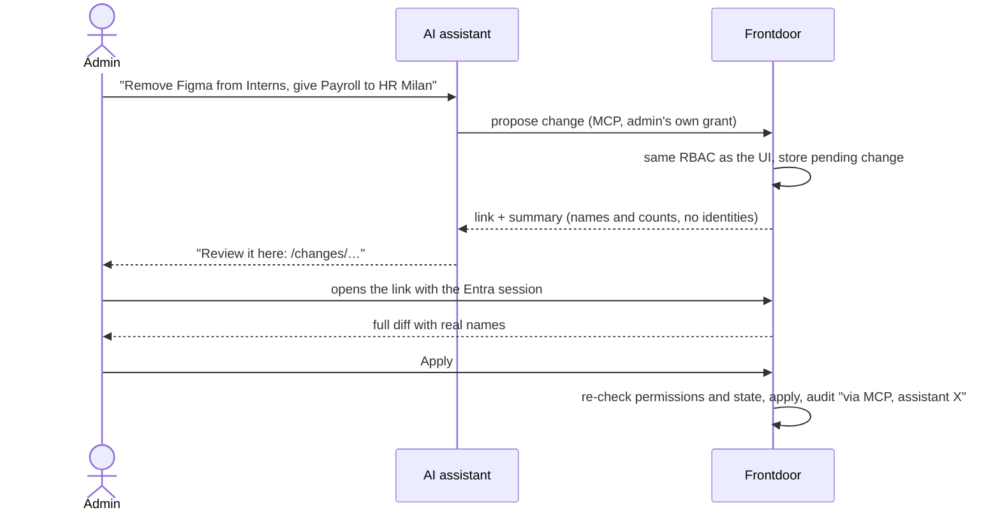

<!-- PR description for feat/mcp-server → BuildBandits/frontdoor-oss main (#167, in review, stacked on #172). -->

> **Merge after #172** (design and ADRs, documentation only). This PR is stacked on it: until #172 merges, the diff here also shows its documents. To review only the implementation, use [this comparison](https://github.com/amargiovanni/frontdoor-oss/compare/docs/mcp-design...feat/mcp-server). To judge the direction first, start from #172.

## The goal

**Frontdoor administration by conversation, with a human always applying the change in Frontdoor.**

An admin asks their AI assistant:

> *"Remove Figma from the Interns group and give Payroll to HR Milan."*

Frontdoor does **not** apply it. It prepares the change and the assistant answers with a link. The admin opens Frontdoor, sees the exact diff with real names (who gains and who loses access to what), and clicks **Apply**. Work that takes dozens of clicks across Apps, Groups and Users becomes one sentence and one review.

The assistant proposes, Frontdoor decides, the human confirms with their own Entra session. A prompt injection (a malicious app description or group name read by the model) can at worst produce a proposal nobody applies. Identity stays with Microsoft Entra, and nothing reaches the AI provider that would let it into the tenant.

## The plan: three phases, this PR is phase 1

Tracked in #171, which holds the plan, the alternatives considered and the checklist for each phase.

| Phase | What users get | Status |
| --- | --- | --- |
| **1. Foundation: read and own preferences** | "Where is the holiday portal?", "which tools do I have for accounting?", "who can open Payroll, and through which group?" (admins, counts only), "add Jira to my favourites" | **This PR** |
| **2. Admin write proposals** | The flow above: the assistant proposes group ↔ app visibility changes, then app creation and edits, then Entra import and resync; the admin reviews the diff and applies it with one click in Frontdoor | Next, once phase 1 holds in production. Spec of the first step: [`04-phase2-spec.md`](https://github.com/amargiovanni/frontdoor-oss/blob/feat/mcp-server/docs/design/mcp/04-phase2-spec.md) (in #172); roadmap: [`03-roadmap.md`](https://github.com/amargiovanni/frontdoor-oss/blob/feat/mcp-server/docs/design/mcp/03-roadmap.md) |
| **3. Log answers for owners** | "Which apps has nobody opened in 90 days?", "top 5 apps this month" — aggregates only, never rows, behind a separate owner switch | After phase 2, with a DPIA screening first |

Phase 1 looks small from the outside, but it carries the hard part. Everything phase 2 needs on the security side ships here and is already reviewed and tested:

| Phase 2 needs | Phase 1 delivers |
| --- | --- |
| The assistant acts as one specific admin, never as itself | OAuth 2.1 authorization server, per-user grants, Entra sign-in (ADR 0003) |
| Only assistants the organisation approved | Owner allowlist, kill switch (ADR 0004) |
| No authorization path parallel to the UI | Visibility and admin queries moved into services shared by routes and tools |
| Nothing leaks to the provider | Fail-closed output projections, tested per tool |
| A Frontdoor page to confirm on that cannot be framed or driven cross-site | The consent page pattern: browser-bound, `frame-ancestors 'none'`, strict same-origin API |
| Traceability | Audit entries name the assistant behind each action |
| Revocation that works at once | Per connection, per assistant, on user deactivation, global |

Phase 2 then adds the pending-change model and its `/changes/:id` confirmation page on top. The full proposal, with its principles and non-goals (no other IdP, no owner functions via MCP, no generic tools, no AI model inside Frontdoor), is in [`01-proposal.md`](https://github.com/amargiovanni/frontdoor-oss/blob/feat/mcp-server/docs/design/mcp/01-proposal.md).

## ⚠️ Not mergeable yet: a decision is needed first

This PR overlaps with **#168** (security fix for plugin webhooks) in `server/services/networkGuard.js`, and the two cannot both land as they are. Before merging, the maintainers need to decide what to keep:

| | #167 (this PR) | #168 |
| --- | --- | --- |
| Connect-time address check | adds `publicOnlyLookup` | adds the same `publicOnlyLookup` |
| Outbound request helper | `fetchPublicJson` (GET, JSON, size cap) for client metadata documents | `requestPublic` (any method, status only) for webhooks |
| `isPublicDestination` | kept (still used by `plugins.js` here) | removed (no longer used) |
| Extra blocked IPv6 ranges (NAT64 `64:ff9b::/96`, `64:ff9b:1::/48`, `100::/64`, 6to4 `2002::/16`, `fec0::/10`, `::/96`) | added (security review, finding 7c) | not included |

**Proposed resolution:**

1. Merge #168 first: it is small, fixes a vulnerability on its own and has no dependency on this PR.
2. Rebase this PR on `main`: keep #168's `publicOnlyLookup`, build `fetchPublicJson` on the same guarded core as `requestPublic` instead of a second copy, drop `isPublicDestination` as #168 does.
3. Decide where the extra IPv6 ranges go: they protect webhooks as much as the MCP metadata fetch, so they arguably belong in their own small security PR rather than in this feature.

Also required before merging (tracked in #171):

- [ ] #172 merged (design and ADRs this PR is stacked on).
- [ ] A check with a commercial assistant (Claude, ChatGPT or Copilot Studio) against a public https staging instance (the local end-to-end check is in `docs/design/mcp/reviews/2026-11-03-e2e-local.md`).
- [ ] The web docs page in BuildBandits/frontdoor.buildbandits.com (follow-up PR there).

## Summary of this PR (phase 1)

Adds an optional MCP server so people use Frontdoor from the AI assistant they
already have (Claude, ChatGPT, Copilot Studio, VS Code): find the apps they can
open, and set their favourites, colour scheme and language; admins get
read-only answers about apps and groups (counts, never identities). It ships
**off**: the owner turns it on and approves each assistant.

## Related issue

Part of #171 (phase 1 of 3; the issue stays open for phases 2 and 3). Proposal and decisions in `docs/design/mcp/` and ADRs 0001–0004.

## Type of change

- [ ] Bug fix
- [x] New feature
- [ ] Refactor / internal change (no user-visible behavior change)
- [x] Documentation
- [ ] Other:

## What changed

- **Authorization server** (`server/services/mcp/oauth.js`, `server/routes/oauth.js`):
  RFC 8414 / RFC 9728 metadata, authorization code with PKCE S256 and RFC 8707
  resource required, RFC 9207 `iss`, browser-bound consent, opaque tokens
  stored as SHA-256 hashes (10 min access, rotating refresh with reuse
  detection), RFC 7009 revocation. Clients are owner-approved: client metadata
  documents (fetched with a connect-time SSRF guard) or registered clients with
  a secret. No DCR (ADR 0004). Sign-in stays with Microsoft Entra; no Entra
  token is ever issued to or accepted from an assistant (ADR 0003).
- **MCP endpoint** (`server/routes/mcpEndpoint.js`, `server/services/mcp/tools.js`):
  SDK v2 handler (ADR 0002), Origin check, per-IP and per-connection rate
  limits, 64 KiB body cap; 8 tools whose results are built only from declared
  field lists (`projection.js`), with a test that fails on any other field.
- **Shared services**: app visibility, the admin app list and the admin group
  list moved out of the routes into `appCatalog.js` / `groupCatalog.js`, so
  routes and tools use the same queries (characterisation tests first).
- **Data**: `server/migrations/mcp.js`, the first migration with a tested
  `down()`; MCP tokens, codes and pending consents are never archived and are
  emptied by a restore.
- **UI**: consent page `/connect/:id`, error page `/connect`, and an *AI
  assistants* page (account menu) for users' connections and the owner's
  controls (switch, approved assistants, disconnect everyone).
- **Docs**: `docs/mcp.md` (operators, DPO), SECURITY.md pointer, FEATURES.md,
  CHANGELOG.

## Breaking changes

None. With the MCP off (default) every new route answers 404. Backups now leave
out three new tables (empty unless the MCP was used).

## New dependencies

`@modelcontextprotocol/server` 2.4.0, `@modelcontextprotocol/express` 2.0.2,
`@modelcontextprotocol/node` 2.1.2 (Apache-2.0; brings `hono` 4.13.16 and
`@hono/node-server` 2.1.6) and `zod` 4.6.7 (already in the tree).
`npm audit --omit=dev`: 0 vulnerabilities.

## Screenshots

Local instance with demo data (`DEV_LOGIN`). Files are in `docs/design/mcp/screenshots/`.

**Consent page** — what the assistant will and will never see, the signed-in account, and where the user returns. Generated from VS Code's real client metadata document.

**AI assistants page** (account menu) — the user's connections with *Disconnect*; for the owner, the on/off switch and the MCP endpoint.

**Approved assistants** (owner) — client metadata documents and registered clients, with active connections.

**Adding an assistant and disconnecting everyone** (owner).

**Unknown assistant** — Frontdoor shows its own error page and never redirects to the `redirect_uri` it was given.

## Checklist

- [x] I have read [CONTRIBUTING.md](../CONTRIBUTING.md).
- [x] All commits are **signed off** (DCO).
- [x] Lint and tests pass locally: `npm run lint` and `npm test`.
- [x] I updated `CHANGELOG.md` under `[Unreleased]`.
- [x] I updated relevant documentation (`FEATURES.md`, `SECURITY.md`, `docs/mcp.md`). The web docs page in BuildBandits/frontdoor.buildbandits.com is a follow-up PR.
- [x] No PII (emails, names, tokens) in new log statements.
- [x] New SQL queries are parameterized.
- [x] New HTML rendered from user input goes through DOMPurify (none: React text only).

## Security impact

High: a new authorization server and a new authenticated endpoint. Threat model
in `docs/design/mcp/02-phase1-spec.md` §11; every rule in §4 has a test, and the
critical checks (same-origin decision, browser binding, code burning, PKCE,
fail-closed projection) were mutation-checked. An independent adversarial
review is recorded in `docs/design/mcp/reviews/`. Two pre-existing issues found
along the way are reported separately, not fixed here (see `tasks/todo.md`).

## How to test

1. `npm ci && npm run build`, then `DEV_LOGIN=true FRONTEND_URL=http://localhost:3001 npm start`.
2. Sign in as Owner, open *AI assistants*, switch it on, add a *Registered client*
   with redirect `http://127.0.0.1:8765/callback`; copy the ID and secret.
3. Follow `docs/design/mcp/reviews/2026-11-03-e2e-local.md` (authorize URL with
   PKCE, consent, `curl` token exchange, `tools/list`, `tools/call`).
4. Or connect Claude Code via CIMD: add `https://claude.ai/oauth/claude-code-client-metadata`
   as a metadata document, then `claude mcp add --transport http frontdoor http://localhost:3001/mcp`.
